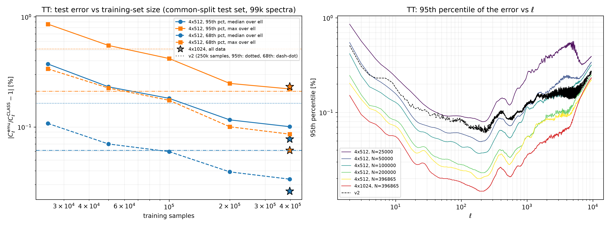

# Training of the ede-v3 emulators (October 2026)

Same CLASS-EDE training set as v2 (`../README.md`, Google Drive folder `ede-final`), all networks retrained.

## Data

- Non-CMB observables (PKL, PKLCB, PKNL, PKNLCB, DAZ, HZ, S8Z, DER): the 2024 training/test sets; PKNL and PKNLCB after `../retraining_2026/clean.py` (spectra identical to the linear one and HMcode glitches removed).
- CMB observables (TT, EE, BB, PP, uTT, uEE, uBB, TE, uTE): `build_common_split.py` pools the 2024 training and test sets of each observable, matches the 496,081 CLASS-EDE runs through their input parameters and applies one 80/20 split shared by all CMB observables, so that row i is the same run in every file. The 2024 sets were split independently per observable (4,793 runs were in the test sets of TT, EE and TE together).
- TE: the target is `atanh(r_l)`, `r_l = C_l^TE / sqrt(C_l^TT C_l^EE)` (`build_common_split.py`, `build_ruTE.py` for the unlensed spectra). TE is reconstructed as `tanh(r_l) sqrt(TT EE)` with the TT and EE emulators.
- The silent HMcode failures of CLASS-EDE affect only the P(k) returned by `pk()`: lensed TT/EE and C_L^phiphi of the failed runs agree with the other runs to better than 0.002% (checked on 3,219 failed and 14,861 good runs).

## Training

`train_v3.py`: JAX implementation of the cosmopower network (alpha-beta activations), loss = RMS of the normalised features, Adam with learning rates 1e-2, 1e-3, 1e-4, 1e-5, 1e-6 (patience 100, batch 1024), global-norm gradient clipping 1.0, 10% of the training set for early stopping. Run with `JAX_DEFAULT_MATMUL_PRECISION=highest`: the default TF32 matrix products of recent NVIDIA GPUs increase the test errors by 20-35%. All training samples are used (v2 used 250,000 of the 396,864 for TT, EE, BB, PP, uTT, uEE, uBB).

`runner.py` with `make_jobs.py`, `make_jobs3.py`, `make_jobs_cs.py`: scaling (N = 25k to 397k) and capacity (4x512, 4x1024, 6x1024; PCA 64/128/256 and r_l for TE) runs on two GPUs. `select_v3.py` picks the run with the lowest median over modes of the 95th-percentile test error; `export_v3.py` writes the three file formats.

## Evaluation

`eval_v2.py` (v2 on its own 2024 test sets), `summarize.py`, `eval_te.py` (TE in units of the cosmic-variance error per l, sigma_l = sqrt((C_TT C_EE + C_TE^2)/(2l+1)), on 19,841 runs that are in the common-split test set and in the 2024 TE test set). Accuracy tables are in `../../README.md`.

Test error against training-set size for TT (`plot_scaling_tt.py`):

The error decreases as about N^-0.4 between 100k and 397k samples for 30 < l < 3000 (no saturation); above l ~ 5000 it reaches 0.2-0.25% independently of N and network size.

Paths in the scripts are those of the training machine.
